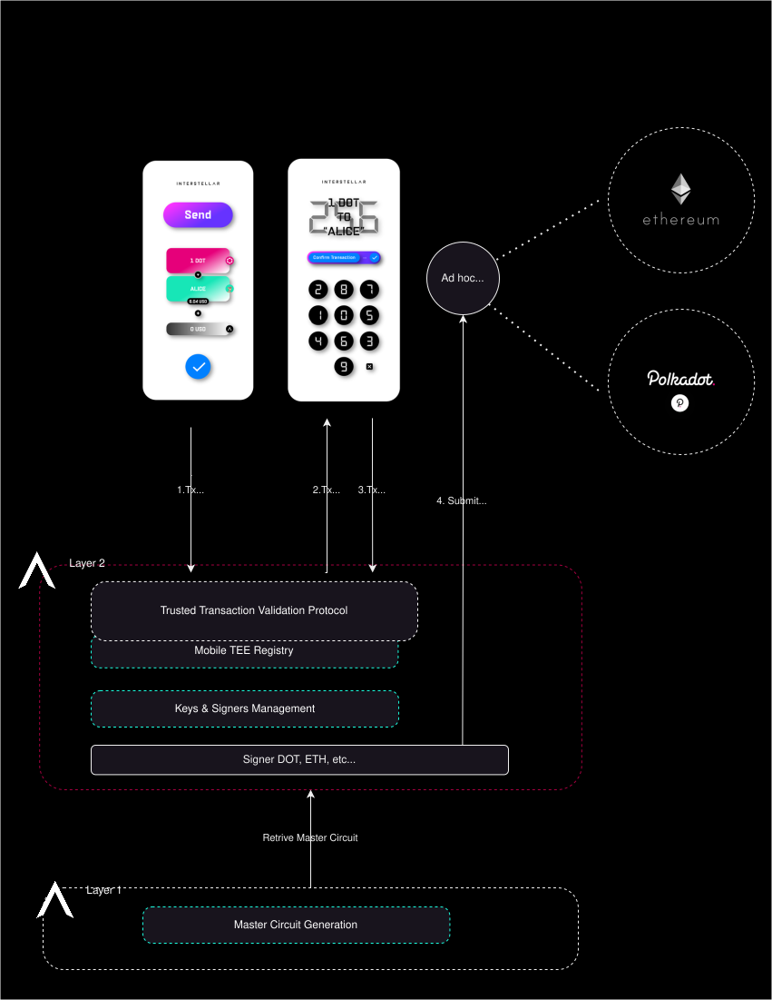

# Trusted Transaction Validation Protocol

The purpose of the Trusted Transaction Validation Protocol is to provide a decentralized feature managed by a blockchain to authenticate and validate a transaction in a higly secure but frictionless way.

## Trusted Transaction Validation Protocol architecture - TTVP

The following schema shows the main components of Interstellar blockchain including the modules related to Trusted Transaction Validation Protocol in both mobile device and in blockchain nodes.

## High level components related to TTVP in Interstellar blockchain

Those modules are based on Parity Substrate nodes and IntegriTEE workers.

### GC (garbled Circuit)  Secure UI Layer 
The mobile transaction screen is managed with Garbled Circuits that are computed on TEE nodes and provisioned on the mobile by the nodes. The one-time code secret and keypad topology cannot be accessed during Garbled Circuit execution to display the Visual Cryptography secret frames that appears only in the users' eyes.  Thanks to persistence of vision. (cf [Visual Cryptography Display](./VC-GC.md) and [Trusted Authentication and User Interface](./TAUI.md))
The generation of the logical circuit used to display the transaction validation screen is managed on the layer 1 and passed on the TEE layer 2 where this circuit is customized based on the transaction parameters, then randomized and garbled before it is sent to the mobile. 

### Mobile Proxy Private Key enables Trusted Hardware Based Authentication
A Public/Private key pair is generated in the mobile hardware protected secure element. We call this  private key, the mobile proxy private key that is not accessible by anyone, even when the device is rooted. The signature is only triggered with the user's biometrics (also managed with TEE).
The public Key is sent to the nodes and managed in the Mobile Registry (described below)

Actually we replace the wallet private keys by a hardware protected proxy mobile private key. This protected key act as a proxy to all the wallet keys owned by the user.

> It is securely tied to the user account and Mobile Proxy Public Key. The wallet private keys associated with the user's assets are managed in the blockchain hardware enclave TEE nodes in `Keys & Signers Management` module. 

In order to prevent potential attacks on hardware enclaves down the road, we will also use at a later stage Multi Party Computation and especially Threshold Signature Scheme.

 
### Mobile Registry pallet
The [substrate module](./Mobile_Registry.md) in charge of mobile device public key registration and mobile device management. The public key associated to the mobile proxy private key is also transmitted to Layer 2 to enable verification of signatures from the mobile.

#### Attestation management (roadmap)

[Key and ID Attestation  |  Android Open source project](https://source.android.com/security/keystore/attestation)

[How to check whether Android phone supports TEE- Stack Overflow](https://stackoverflow.com/questions/61225795/how-to-check-whether-android-phone-supports-tee/64422042#64422042)
 

#### Behavioral Biometric (roadmap)
Each user has a unique typing pattern for a sequence of digits on a keypad. If a bad actor tries to replicate this pattern, it will be detected with a 98% success rate. This feature will be managed by TEE nodes with Machine Learnings classification models based on secret touch screen position inputs received by the nodes and their related authenticated timestamps.

[TOUCH DYNAMICS BIOMETRICS TO ENHANCE AUTHENTICATION ON MOBILE DEVICES](https://www.research.manchester.ac.uk/portal/files/159168194/FULL_TEXT.PDF)

## Future Plans

### Potential Research project:

The issue that requires investigation is the increasing sophistication and effectiveness of targeted malware attacks, particularly those that utilize a 0-day vulnerability to establish a rootkit. This is a crucial matter to address as such attacks can cause significant harm to individuals and organizations.

Targeted attacks with rootkit capabilities are highly elusive, as an attacker with malware and root privileges can quickly disable any type of system or network monitoring. This is made even more challenging by the fact that the attacker has access to the entire system's resources and can alter the memory and code of any application. Furthermore, it is even more difficult to detect such attacks when the targeted application lacks root privileges, as the attacker has an advantage in terms of access and control.

Despite the challenges presented by rootkit-enabled targeted attacks, we think that our security and authentication framework (decentralized & distributed) can be used to design a real-time targeted attack detection that focuses on our transaction validation/sensitive operation session. This is made possible by our use of hardware protected signature on mobile and the computation privacy and protection of inputs of garbled circuit evaluation. By leveraging these advanced security measures, we can enhance our ability to detect and prevent targeted attacks, even those with rootkit capabilities.

### Future security framework
The proposed system incorporates multiple security layers to increase the cost of targeted attacks on mobile user interface (UI) software.

The first layer focuses on the security of transaction confirmation, using features such as TUI and Android protected confirmation.

The second layer adds an additional layer of security through behavioral biometrics, such as keypad pressure and input timestamps, making it difficult for attackers to replicate the user's input. [99% proven success rate model]( https://book.interstellar.gg/TTVP.html#behavioral-biometric-roadmap)

**Bug bounty program**: To encourage security researchers in conducting targeted attacks on our system. This will also train the model and improve its accuracy while also assisting developers in enhancing the system security framework.

### Potential Guarantee fund backed by reinsurance service

Establishing a guarantee fund for individual and corporate users could be a sensible option given the level of security achieved by the system.

With the multi-layer security system described earlier, it is easy to enable users to securely provide their mobile device forensic data in a simple manner to verify potential claims.

### Some potential other improvements:

- Filecoin may allow for the backup and retrieval of private keys using Shamir Secret Sharing.

- Private scheme like stealth address can be added to the system

- Enhancement of distributed HSM based on TEE with hardware HSM module on some nodes
